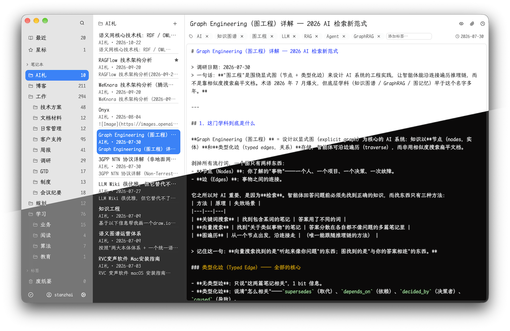

# Leanote Desktop App

蚂蚁笔记客户端。默认markdown + vim编辑模式，Native高性能客户端。



## Rust 重写版（GPUI）

本仓库含一套完整的 Rust 重写（`rust/`）：SQLite 存储、leanote 同步引擎、本地 HTTP/MCP（127.0.0.1:8912）、三栏 GPUI 桌面端与命令行工具，与 Electron 版线协议、CLI 字节输出、MCP 行为对拍一致。详见 `rust/README.md`。

### 开发与运行

```sh
cd rust
cargo build --release            # 产出 target/release/Leanote（GUI）与 leanote（CLI）
cargo test                       # 全工作区测试（218 个）
./target/release/Leanote         # 直接运行桌面端

# 冒烟（假服务器 + 自动登录，无需真实账号）：
LEANOTE_DATA=/tmp/smoke LEANOTE_FAKE_SERVER=1 LEANOTE_FAKE_AUTOSUBMIT=1 ./target/release/Leanote
```

数据目录：`~/Library/Application Support/leanote/`（win `%APPDATA%\leanote`、linux `~/.config/leanote`，可用 `LEANOTE_DATA` 覆盖）；与 Electron 遗留 NeDB（`nedb55/`）同目录共存但永不互读写（ADR-0008）。日志：`<数据目录>/logs/app.log`；`LEANOTE_MCP_DEBUG=1` 时追加 `~/leanote_mcp.log`（与 JS 版一致）。

导出：笔记右键菜单 / 标题栏 ⋯ 菜单 →「导出为…」二级子菜单（Markdown / HTML / PDF / Word），全部本地转换（PDF 用内嵌 typst，Word 用 knit-md-docx 纯 Rust 链路）；另有全库 `.leanote` JSON 备份。保存面板记住上次导出目录（首次 `~/Downloads`）。窗口拖拽：导航头、阅读条、编辑条与编辑器标题行空白处均可拖动窗口（win HTCAPTION / linux start_window_move / mac AppKit）。

### 打包

```sh
sh rust/scripts/package-macos.sh aarch64            # 本机架构；x86_64 同理
sh rust/scripts/package-linux.sh x86_64             # 需 dpkg-deb + patchelf
powershell rust/scripts/package-windows.ps1 -Arch x64   # 需 makensis (NSIS)
```

产出 `dist/Leanote_<ver>_<os>_<arch>.{dmg,AppImage,deb,exe,zip}`。GUI 二进制名 `Leanote`，CLI 随包（mac `.app` 内为 `leanote-cli`，win 在 `bin\leanote.exe` 可选加 PATH，linux `/usr/bin/leanote`）。图标源 `build/icon.png`，经 `rust/scripts/gen-icons.sh` 再生成入库。

推 `v*` tag 触发 `.github/workflows/release.yml`：6 目标（mac/win/linux × x64/arm64）并行构建，产物自动附到 GitHub Release。

验收脚本：`sh rust/scripts/acceptance-macos.sh`（CLI/HTTP/MCP/日志/打包产物，15 项）。

### 发布签名（消除 Gatekeeper「已损坏」/ SmartScreen 拦截）

不配置时 mac 为 ad-hoc 签名、win 未签名，产物从 Releases 下载后分别被 Gatekeeper（「已损坏，应移到废纸篓」）和 SmartScreen（「Windows 已保护你的电脑」）拦截。在 repo Settings → Secrets and variables → Actions 配好下列 secrets 后，下一个 `v*` tag 自动走正式签名 + 公证（详见 `docs/adr/0012`）；未配置则照旧发无签名版。

**macOS（需 Apple Developer Program，$99/年）：**

1. 在 developer.apple.com 后台创建 `Developer ID Application` 证书并安装到钥匙串；
2. 钥匙串访问中把证书 + 私钥导出为 `.p12`（设密码），`base64 -i cert.p12 | pbcopy`；
3. 在 appleid.apple.com 创建 App 专用密码（公证用）；
4. 配 5 个 Secrets：

| Secret | 值 |
|---|---|
| `MACOS_CERT_P12_BASE64` | p12 的 base64 |
| `MACOS_CERT_PASSWORD` | p12 导出密码 |
| `APPLE_ID` | Apple ID 邮箱 |
| `APPLE_APP_SPECIFIC_PASSWORD` | App 专用密码 |
| `APPLE_TEAM_ID` | 10 位 Team ID（会员后台 Membership 页） |

**Windows（需代码签名证书）：**

购买 OV/EV 证书并导出含私钥的 `.pfx`，base64 用 PowerShell：`[Convert]::ToBase64String([IO.File]::ReadAllBytes('cert.pfx'))`，配 2 个 Secrets：`WINDOWS_CERT_PFX_BASE64`、`WINDOWS_CERT_PASSWORD`。

签名生效后 mac 首次启动显示「已从互联网下载」属预期（公证版正常提示）；Windows SmartScreen 信誉随下载量积累，EV 证书即时。（Azure Trusted Signing $9.99/月不走 PFX 路径，选用需改 `package-windows.ps1` 的签名调用。）

### CLI 与 MCP 对拍

```sh
LEANOTE_PORT=8913 bash rust/crates/leanote-cli/compare-with-js.sh . rust/target/debug/leanote   # JS/Rust CLI 逐字节对比（56/56）
LEANOTE_RUST_MCP=1 node tests/test_mcp_server.js                    # 未修改的 JS 测试跑 Rust MCP
LEANOTE_RUST_MCP=1 node tests/test_mcp_sse.js
LEANOTE_RUST_MCP=1 node tests/test_mcp_stateless.js
```

## Package

```shell
nvm use v18
npm run build
```

## Command Line Interface

Leanote 桌面客户端启动后会自动安装 `leanote` 命令行工具，无需系统安装 Node.js。

```bash
# 添加笔记
leanote -t "标题" -c "# Markdown 内容" -g "标签1,标签2"
leanote add -t "标题" -c "内容" -n "AI札" -g "test"

# 通过管道传入内容
echo "# Hello" | leanote -t "管道测试"

# 列出最近笔记
leanote list                  # 最近的 20 条
leanote list -n "AI札"        # 按笔记本过滤
leanote list -g "work"        # 按标签过滤
leanote list -v -N 5          # 显示内容预览，限定 5 条

# 查看笔记完整内容（支持 ID 前缀匹配）
leanote show a1b2c3d4

# 搜索笔记（匹配标题、内容、标签，按相关度排序）
leanote search "关键字"
leanote search "meeting" -N 10

# 编辑笔记
leanote edit a1b2c3d4 -t "新标题"
leanote edit a1b2c3d4 -g "urgent,important"   # 替换标签
leanote edit a1b2c3d4 -n "其他笔记本"          # 移动笔记
echo "# 新内容" | leanote edit a1b2c3d4 -c -  # 管道更新内容
```

## MCP Server

Leanote 桌面客户端启动后会在本地开启 **MCP Server**（Model Context Protocol，Streamable HTTP），让 AI 智能体（Claude Desktop、Cursor 等）通过标准协议管理笔记。

- 端点：`http://127.0.0.1:8912/mcp`（仅绑定本机回环 127.0.0.1，需 app 在运行）
- 与 CLI 文件 I/O 模式一致：直接读写本地 NeDB 文件，写入的笔记带同步标记（`IsDirty`），app 下次加载/同步时生效

### 工具

| 工具 | 说明 |
|---|---|
| `list_notebooks` | 列出所有笔记本及笔记数量 |
| `list_tags` | 列出所有标签 |
| `add_note` | 新建 Markdown 笔记（`title` / `content` / `tags` / `notebook`，默认笔记本 "AI札"，不存在则自动创建） |
| `list_notes` | 列出最近笔记，可按 `notebook` / `tag` 过滤 |
| `get_note` | 按 ID（或前缀）查看笔记完整内容 |
| `search_notes` | 按关键字搜索（标题 / 正文 / 标签），按相关度排序 |
| `update_note` | 更新笔记（`title` / `content` / `tags` / `notebook`） |
| `delete_note` | 移到回收站 |

### 智能体配置

在 Claude Desktop / Cursor 等的 MCP 配置中加入（Streamable HTTP）：

```json
{
  "mcpServers": {
    "leanote": { "url": "http://127.0.0.1:8912/mcp" }
  }
}
```

### 调试

```bash
npx @modelcontextprotocol/inspector
# Transport 选 Streamable HTTP，URL 填 http://127.0.0.1:8912/mcp
```

仓库内附冒烟测试：`node tests/test_mcp_server.js`（需本机已有 Leanote 数据）。

## LICENSE

[LICENSE](https://github.com/leanote/desktop-app/blob/master/LICENSE)

```
LEANOTE - NOT JUST A NOTEPAD!

Copyright by the contributors.

This program is free software; you can redistribute it and/or modify
it under the terms of the GNU General Public License as published by
the Free Software Foundation; either version 2 of the License, or
(at your option) any later version.

This program is distributed in the hope that it will be useful,
but WITHOUT ANY WARRANTY; without even the implied warranty of
MERCHANTABILITY or FITNESS FOR A PARTICULAR PURPOSE.  See the
GNU General Public License for more details.

Leanote destop app is licensed under the GPL v2.
```
